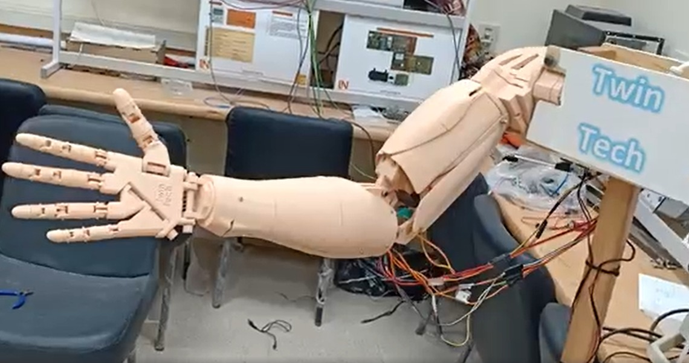
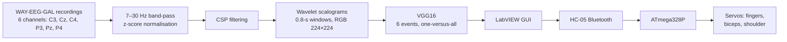

# EEG-controlled 3D-printed prosthetic arm

B.Sc. graduation project at Helwan University, Cairo (2022): Fady Mostafa (Mechatronics Engineering) with Amr Mostafa and
Sara Ahmed (Biomedical Engineering). Published at the 6th International Undergraduate Research Conference (IUGRC):

> Amr Mostafa, Fady Mostafa, Sara Ahmed.
> *Prosthetic Arm Using EEG Control Signals Based on Deep Convolutional Neural Network.*
> 6th IUGRC International Undergraduate Research Conference, Military Technical College, Cairo, Egypt, 5–8 September
> 2022, pp. 1–7. [DOI](https://doi.org/10.21608/iugrc.2022.302696) ·
> [PDF](https://journals.ekb.eg/article_302696_23925a2b0a54a898848faa736913ce46.pdf)
>
> Supervisors: Dr Taha H. S. Abdelaziz, Dr Marwa M. A. Hadhoud and Dr Ibrahim Sadek (Helwan University).

<p align="center">
  <a href="https://lnkd.in/p/e9HW7nEJ"></a>
</p>

*The 3D-printed arm with its controller (frame from the project video).*
**[▶ Watch the video on LinkedIn](https://lnkd.in/p/e9HW7nEJ)**

## In short
- **Goal:** decode grasp-and-lift movement events from scalp EEG and use the decisions to move a low-cost 3D-printed
  prosthetic arm.
- **Data:** the public WAY-EEG-GAL dataset ([Luciw, Jarocka & Edin, 2014](https://doi.org/10.1038/sdata.2014.47)):
  12 healthy people performing executed grasp-and-lift movements, 32 EEG channels at 500 Hz. Six movement events were
  classified (labelled HS, GS, LT, HD, RP and RL in the paper).
- **Decoder:** six channels over the motor and parietal cortex, common spatial patterns (CSP), wavelet scalograms and a
  pretrained VGG16 network.
- **Arm:** 3D-printed in PLA, about 80 cm long and 2.25 kg, with servo-driven fingers, biceps and shoulder, controlled
  from a LabVIEW interface over Bluetooth.

## How it works



**Signal processing.** Six of the 32 channels were kept: C3, Cz and C4 over the motor cortex, and P3, Pz and P4 over the
parietal cortex. The signals were band-pass filtered at 7–30 Hz (FIR filter, mu and beta bands), normalised by mean and
standard deviation, and passed through CSP filters. A continuous wavelet transform (analytic Morlet) turned each 0.8-s
window (400 samples, 100-sample overlap) into a scalogram. The scalograms of three channels were stacked as the red,
green and blue layers of one 224×224 image: one image from C3, Cz and C4, and one from P3, Pz and P4.

**Classifier.** A pretrained VGG16 network was trained in Python on Google Colab with 6,960 scalogram images, generated in
equal numbers for the six events. The images were split 80/20 into training and test sets, and each event was tested
one-versus-all.

**Arm.** The arm has hand, forearm, biceps and shoulder sections, and was modelled as a two-degree-of-freedom planar arm for
the kinematics (Denavit–Hartenberg parameters) and dynamics (Lagrange equations). An MG995R servo drives each finger, an
MG996R servo the biceps (flexion and extension) and an FS5113R servo the shoulder (forward and backward). An ATmega328P
microcontroller receives the decisions from LabVIEW through an HC-05 Bluetooth module. A 12 V, 3 A supply with a buck
converter to 5 V powers the control circuit. The LabVIEW interface also shows the EEG processing and computes the
position, velocity, acceleration and torque of each joint.

## Results as published
- **Average accuracy: 90.2%** (abstract and conclusion), for the six events tested one-versus-all on the test set.
- **Per event** (Fig. 13 of the paper, read from the bar chart): from about 84% (HS) to about 93% (RL).

## How to read these numbers
- **No live user controlled the arm.** The arm was driven from LabVIEW with the decoder's decisions on recorded EEG from
  the public dataset. No EEG was recorded from a person wearing a headset. The paper calls the setup semi-real-time and
  lists live use with an OpenBCI headset as future work.
- **The movements were executed, not imagined, and the people were healthy, not amputees.**
- **The test set is not a new person.** The 80/20 split is over scalogram windows, and the paper does not state that
  windows from the same person or trial were kept on one side. Overlapping windows from the same recordings on both
  sides make the test accuracy optimistic compared with testing on a new person.
- **One-versus-all accuracy needs its baseline.** The paper does not report how each one-versus-all test was balanced.
  If the "all" side held the other five events in full, always answering "not this event" would already score 83.3%.
- **The average and the figure differ.** The six bars in Fig. 13 average about 88%, and the paper does not say how the
  90.2% average was computed.

This was an undergraduate project. It built the complete chain from EEG decoding to a moving arm, but it did not test
decoding on new people or in real time.

## Where is the code?
The original source code and LabVIEW files of this project were lost and could not be recovered. This repository
documents the system and the published results. It contains no runnable code, and nothing here has been re-run.

## What came next
- **M.Sc. project: [realtime-bci-hand-exoskeleton](https://github.com/fady-mostafa-omar/realtime-bci-hand-exoskeleton).**
  The same public dataset was used to train a decoder that then ran live: a consumer EEG headset, real-time decoding on
  a Jetson Nano, a 3D-printed hand exoskeleton, and tests with five volunteers (IEEE NILES 2025).
- **Follow-up study: [movement-library-calibration](https://github.com/fady-mostafa-omar/movement-library-calibration).**
  A controlled offline test, on 15 people, of how much of a new user's calibration a decoder built from other people's
  executed movements replaces, with leave-one-subject-out testing and all code and per-person results public
  (manuscript under review).

## Citation
```bibtex
@inproceedings{mostafa2022prosthetic,
  title     = {Prosthetic Arm Using {EEG} Control Signals Based on Deep Convolutional Neural Network},
  author    = {Mostafa, Amr and Mostafa, Fady and Ahmed, Sara},
  booktitle = {6th IUGRC International Undergraduate Research Conference},
  address   = {Military Technical College, Cairo, Egypt},
  pages     = {1--7},
  year      = {2022},
  doi       = {10.21608/iugrc.2022.302696}
}
```

## Acknowledgements
The project was supervised by Dr Taha H. S. Abdelaziz, Dr Marwa M. A. Hadhoud and Dr Ibrahim Sadek at Helwan University.
The paper also thanks Eng. Ibrahim Badawy of the Mechatronics Engineering Department at Helwan University.

## License
The text of this repository is licensed under [CC BY 4.0](LICENSE). The photos and video frames are © the authors;
please ask before reusing them. The paper itself is not included here; it can be read through the DOI link above.
